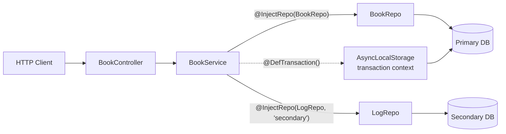
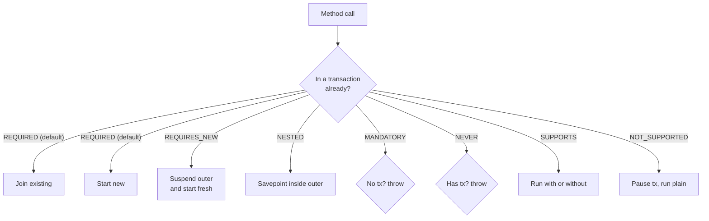

# nestjs-typeorm3-kit

<p>
  <a href="https://www.npmjs.com/package/nestjs-typeorm3-kit"></a>
  <a href="https://www.npmjs.com/package/nestjs-typeorm3-kit"></a>
  <a href="./LICENSE"></a>
  
  
  
  
  
</p>

A NestJS toolkit for **TypeORM 0.3.x** that brings back the ergonomic `@EntityRepository` pattern, adds first-class multi-DataSource support, decorator-based transactions, Swagger helpers, and a safer `findOne`.

This package is also a **wrapper fork of [`typeorm-transactional`](https://github.com/Aliheym/typeorm-transactional) `v0.5.0`** — the transactional layer is vendored inside the package with `cls-hooked` removed, so transactions work on both Node.js and Bun without installing anything extra.

> 📚 **Looking for deep dives?** The [`docs/`](./docs) folder has bilingual
> (EN / VI) guides for every feature with full option references and
> common pitfalls.

## Highlights

- 🧩 `@DefEntityRepository` + `@InjectRepo` — repository pattern with multi-DataSource support
- 🔁 `@DefTransaction` — decorator-based transactions, works on Node **and** Bun
- 🛡️ `RepositoryWrapper` — hardens `findOne`, `findOneBy` and their `*OrFail` variants against TypeORM's "first row on undefined where" footgun
- 🎯 `@DefController`, `@DefGet/Post/Put/Patch/Delete` — less boilerplate, auto Swagger metadata
- 🌳 `@ChildModule` — nested route prefixes + auto `ApiTags`
- 📜 `configSwaggerDocument` — merges `class-validator` metadata into the OpenAPI doc
- ⚡ `lazyLoadClasses` — auto-discover controllers/services by file suffix

---

## Table of contents

1. [Installation](#1-installation)
2. [Quick start](#2-quick-start)
3. [Tutorial — build a multi-DataSource app step by step](#3-tutorial--build-a-multi-datasource-app-step-by-step)
   - [3.1 Set up DataSources](#31-set-up-datasources)
   - [3.2 Write your first repository](#32-write-your-first-repository)
   - [3.3 Wire the repository module](#33-wire-the-repository-module)
   - [3.4 Inject the repository into a service](#34-inject-the-repository-into-a-service)
   - [3.5 Add a controller](#35-add-a-controller)
   - [3.6 Group modules with `@ChildModule`](#36-group-modules-with-childmodule)
   - [3.7 Add transactions](#37-add-transactions)
   - [3.8 Enable Swagger](#38-enable-swagger)
4. [Relationship to `typeorm-transactional`](#4-relationship-to-typeorm-transactional)
5. [Repository API](#5-repository-api)
6. [Transactions](#6-transactions)
7. [Controller & module helpers](#7-controller--module-helpers)
8. [Swagger helper](#8-swagger-helper)
9. [Validation decorators](#9-validation-decorators)
10. [Utilities](#10-utilities)
11. [Full example](#11-full-example)
12. [Testing](#12-testing)
13. [Compatibility](#13-compatibility)
14. [Troubleshooting](#14-troubleshooting)

---

## 1. Installation

<details>
<summary><b>npm</b></summary>

```bash
npm install nestjs-typeorm3-kit
```

</details>

<details open>
<summary><b>yarn</b></summary>

```bash
yarn add nestjs-typeorm3-kit
```

</details>

<details>
<summary><b>pnpm</b></summary>

```bash
pnpm add nestjs-typeorm3-kit
```

</details>

<details>
<summary><b>bun</b></summary>

```bash
bun add nestjs-typeorm3-kit
```

</details>

> Starting from **v0.2.0**, `typeorm-transactional` is vendored inside the package — no separate install needed.

**Peer dependencies** (install if you don't have them):

```bash
npm install @nestjs/common @nestjs/core @nestjs/typeorm @nestjs/swagger typeorm reflect-metadata rxjs class-validator class-transformer class-validator-jsonschema libphonenumber-js
```

**Runtime requirement:** Node.js **>= 16.4** or **Bun** for the transactional layer; **NestJS 12 requires Node.js >= 20.19**. The vendored transactional layer uses Node's built-in `AsyncLocalStorage` — there is no `cls-hooked` fallback.

---

## 2. Quick start

A 30-second peek. The full tutorial in [section 3](#3-tutorial--build-a-multi-datasource-app-step-by-step) walks through the same code with explanations.

```ts
// main.ts
import { NestFactory } from "@nestjs/core";
import { setupTransactionContext } from "nestjs-typeorm3-kit";
import { AppModule } from "./app.module";

async function bootstrap() {
  setupTransactionContext(); // MUST run before NestFactory.create
  const app = await NestFactory.create(AppModule);
  await app.listen(3000);
}
bootstrap();
```

```ts
// book.repo.ts
import { Repository } from "typeorm";
import { DefEntityRepository } from "nestjs-typeorm3-kit";
import { Book } from "./book.entity";

@DefEntityRepository(Book)
export class BookRepo extends Repository<Book> {}
```

```ts
// app.module.ts
import { Module } from "@nestjs/common";
import { TypeOrmModule } from "@nestjs/typeorm";
import { DataSource, DataSourceOptions } from "typeorm";
import { addTransactionalDataSource, DefRepositoryModule } from "nestjs-typeorm3-kit";

@Module({
  imports: [
    TypeOrmModule.forRootAsync({
      useFactory: () => ({ type: "postgres", /* ... */ entities: [Book] }),
      // @DefTransaction only works on DataSources registered here
      dataSourceFactory: async (options) =>
        addTransactionalDataSource(new DataSource(options as DataSourceOptions)),
    }),
    DefRepositoryModule.forFeature([BookRepo]),
  ],
  providers: [BookService],
})
export class AppModule {}
```

```ts
// book.service.ts
import { Injectable } from "@nestjs/common";
import { DefTransaction, InjectRepo } from "nestjs-typeorm3-kit";

@Injectable()
export class BookService {
  constructor(@InjectRepo(BookRepo) private readonly repo: BookRepo) {}

  @DefTransaction()
  create(title: string) {
    return this.repo.save({ title });
  }
}
```

---

## 3. Tutorial — build a multi-DataSource app step by step

This walkthrough builds a small Nest app with **two Postgres databases**, repositories, a service that writes across both inside a transaction, a controller, and Swagger. By the end you'll have used every major feature of the kit.

### Architecture at a glance



### 3.1 Set up DataSources

Register each DataSource with `TypeOrmModule` **and** wrap it in `addTransactionalDataSource` so `@DefTransaction` can see it.

```ts
// databases.ts
import { TypeOrmModule } from "@nestjs/typeorm";
import { DataSource, DataSourceOptions } from "typeorm";
import { addTransactionalDataSource } from "nestjs-typeorm3-kit";

const PRIMARY = "default";
const SECONDARY = "secondary";

export const primaryDb = TypeOrmModule.forRootAsync({
  name: PRIMARY,
  useFactory: () => ({ type: "postgres", /* ... */ }),
  dataSourceFactory: async (options) =>
    addTransactionalDataSource({
      name: PRIMARY,
      dataSource: new DataSource(options as DataSourceOptions),
    }),
});

export const secondaryDb = TypeOrmModule.forRootAsync({
  name: SECONDARY,
  // repeat the name here: @nestjs/typeorm reads it from these options on shutdown
  useFactory: () => ({ name: SECONDARY, type: "postgres", /* ... */ }),
  dataSourceFactory: async (options) =>
    addTransactionalDataSource({
      name: SECONDARY,
      dataSource: new DataSource(options as DataSourceOptions),
    }),
});
```

> 💡 `addTransactionalDataSource` is re-exported from `nestjs-typeorm3-kit` so you don't need a second import from `typeorm-transactional`.

### 3.2 Write your first repository

```ts
// book.entity.ts
import { Column, Entity, PrimaryGeneratedColumn } from "typeorm";

@Entity()
export class Book {
  @PrimaryGeneratedColumn() id!: number;
  @Column() title!: string;
}
```

```ts
// book.repo.ts
import { DefEntityRepository, RepositoryWrapper } from "nestjs-typeorm3-kit";
import { Book } from "./book.entity";

@DefEntityRepository(Book)
export class BookRepo extends RepositoryWrapper<Book> {
  findByTitle(title: string) {
    return this.findOne({ where: { title } });
  }
}
```

> ✨ Extending `RepositoryWrapper` instead of plain `Repository` makes `findOne` / `findOneBy` return `null` (instead of a random first row) when the `where` clause has any `undefined` value. See [`RepositoryWrapper`](#repositorywrapper).

### 3.3 Wire the repository module

`DefRepositoryModule` auto-discovers all `*.repo.{ts,js}` files that have a `@DefEntityRepository` decorator and registers them as providers.

```ts
// primary-repo.module.ts
import { Module } from "@nestjs/common";
import { join } from "path";
import { DefRepositoryModule } from "nestjs-typeorm3-kit";

@Module({
  imports: [
    DefRepositoryModule.forRootAsync({
      useFactory: () => ({
        globPattern: join(__dirname, "./**/*.repo.{ts,js}"),
        dataSource: "default",
      }),
    }),
  ],
  exports: [DefRepositoryModule],
})
export class PrimaryRepoModule {}
```

Repeat with `dataSource: "secondary"` for the second connection.

### 3.4 Inject the repository into a service

For the **default** connection, plain constructor injection works.
For a **named** connection, use `@InjectRepo(Repo, connectionName)`.

```ts
// book.service.ts
import { Injectable } from "@nestjs/common";
import { InjectRepo } from "nestjs-typeorm3-kit";
import { BookRepo } from "./book.repo";
import { LogRepo } from "./log.repo";

@Injectable()
export class BookService {
  constructor(
    readonly bookRepo: BookRepo,                          // default connection
    @InjectRepo(LogRepo, "secondary") readonly logRepo: LogRepo, // secondary
  ) {}

  list() {
    return this.bookRepo.find();
  }
}
```

### 3.5 Add a controller

```ts
// book.controller.ts
import { Body, Param, Query } from "@nestjs/common";
import { DefController, DefGet, DefPost } from "nestjs-typeorm3-kit";
import { BookService } from "./book.service";

@DefController("books")
export class BookController {
  constructor(private readonly svc: BookService) {}

  @DefGet("", { summary: "List all books" })
  list(@Query() q: any) {
    return this.svc.list();
  }

  @DefPost("", { summary: "Create a book" })
  create(@Body() body: { title: string }) {
    return this.svc.create(body.title);
  }
}
```

`@DefGet/Post/...` bundle `@Get/@Post`, `@HttpCode`, `@ApiOperation`, `@ApiResponse` (and optionally `@ApiBody`) into one call.

### 3.6 Group modules with `@ChildModule`

`@ChildModule` mounts the module under a route prefix and auto-tags its controllers in Swagger.

```ts
// client.module.ts
import { ChildModule } from "nestjs-typeorm3-kit";

@ChildModule({
  prefix: "client",
  imports: [PrimaryRepoModule, SecondaryRepoModule],
  controllers: [BookController],
  providers: [BookService],
})
export class ClientModule {}
```

Resulting routes: `GET /client/books`, `POST /client/books`. Swagger tag: `[Client] BookController`.

### 3.7 Add transactions

Decorate any service method with `@DefTransaction()`. Without `connectionName` it opens a transaction on the **default** DataSource only: `bookRepo` writes inside it, while `logRepo` (on `secondary`) writes outside it. Two databases cannot share one SQL transaction — see [Multi-DataSource transactions](./docs/en/transaction.md#multi-datasource-transactions).

```ts
// book.service.ts (continued)
import { DefTransaction } from "nestjs-typeorm3-kit";

@DefTransaction()
async create(title: string) {
  const book = await this.bookRepo.save({ title });
  // If this throws, the bookRepo.save above is rolled back too.
  // The log row itself is not transactional: it lives on another DataSource.
  await this.logRepo.save({ action: "book.created", refId: book.id });
  return book;
}
```

#### How propagation works



Pass `propagation`, `isoLevel`, and `connectionName` to target a specific DataSource:

```ts
@DefTransaction({
  connectionName: "secondary",
  propagation: Propagation.REQUIRES_NEW,
  isoLevel: "SERIALIZABLE",
})
async audit(payload: AuditPayload) { /* ... */ }
```

### 3.8 Enable Swagger

```ts
// main.ts
import { NestFactory } from "@nestjs/core";
import { DocumentBuilder, SwaggerModule } from "@nestjs/swagger";
import { configSwaggerDocument, setupTransactionContext } from "nestjs-typeorm3-kit";

async function bootstrap() {
  setupTransactionContext();
  const app = await NestFactory.create(AppModule);

  const options = new DocumentBuilder()
    .setTitle("My API")
    .setVersion("1.0")
    .addBearerAuth()
    .build();

  const document = SwaggerModule.createDocument(app, options);
  configSwaggerDocument(app, document, "swagger"); // → GET /swagger

  await app.listen(3000);
}
bootstrap();
```

That's a full app. The rest of the README is the API reference.

---

## 4. Relationship to `typeorm-transactional`

`nestjs-typeorm3-kit` is a **wrapper fork** of [`typeorm-transactional`](https://github.com/Aliheym/typeorm-transactional). Concretely:

- **Vendored:** the entire `typeorm-transactional@v0.5.0` source lives in [`src/vendor/transactional/`](./src/vendor/transactional). The MIT [LICENSE](./src/vendor/transactional/LICENSE) (Copyright © Ohad David) is preserved verbatim.
- **Wrapped:** `setupTransactionContext` and `@DefTransaction` are thin wrappers over the vendored `initializeTransactionalContext` and `@Transactional` decorators.
- **Re-exported:** `Transactional`, `Propagation`, `IsolationLevel`, `StorageDriver`, `addTransactionalDataSource`, `runInTransaction`, `wrapInTransaction`, `runOnTransactionCommit`, `runOnTransactionRollback`, `runOnTransactionComplete`, `TransactionalError`, `getDataSourceByName`, `deleteDataSourceByName` are all re-exported from `nestjs-typeorm3-kit` so you only need one import path.

<details>
<summary><b>What changed vs. upstream</b></summary>

| Area                                                  | Upstream `v0.5.0`                                     | This fork (v0.2.0+)                                                  |
| ----------------------------------------------------- | ----------------------------------------------------- | -------------------------------------------------------------------- |
| Storage drivers                                       | `cls-hooked` + `AsyncLocalStorage`                    | Only `AsyncLocalStorage`                                             |
| Runtime dependencies                                  | `cls-hooked`, `@types/cls-hooked`, `semver`           | None                                                                 |
| Bun support                                           | ❌ broken (`async_hooks` incomplete)                  | ✅ works                                                              |
| Node requirement                                      | `>= 14`                                               | `>= 16.4`                                                            |
| Public API (decorators, hooks, propagation, isolation)| —                                                     | **Identical**                                                        |
| `initializeTransactionalContext` options              | `{ maxHookHandlers, storageDriver }`                  | `{ maxHookHandlers }` — `storageDriver` removed (only one driver)    |
| `StorageDriver` enum values                           | `AUTO`, `CLS_HOOKED`, `ASYNC_LOCAL_STORAGE`           | `AUTO` (alias), `ASYNC_LOCAL_STORAGE`                                |

</details>

<details>
<summary><b>Migrating from <code>typeorm-transactional</code></b></summary>

```diff
- import { Transactional, Propagation, addTransactionalDataSource } from 'typeorm-transactional';
+ import { Transactional, Propagation, addTransactionalDataSource } from 'nestjs-typeorm3-kit';

- import { initializeTransactionalContext, StorageDriver } from 'typeorm-transactional';
- initializeTransactionalContext({ storageDriver: StorageDriver.CLS_HOOKED });
+ import { setupTransactionContext } from 'nestjs-typeorm3-kit';
+ setupTransactionContext();
```

Then **uninstall** `typeorm-transactional` — it is no longer needed.

</details>

---

## 5. Repository API

### `@DefEntityRepository`

Marks a class as a TypeORM repository bound to an entity. Your class should extend `Repository<Entity>` or `RepositoryWrapper<Entity>`.

```ts
@DefEntityRepository(Book)
export class BookRepo extends Repository<Book> {
  findPublished() { return this.find({ where: { published: true } }); }
}
```

Under the hood the decorator stores the entity on the class via `Reflect.defineMetadata`. `DefRepositoryModule` reads that metadata to wire up providers.

### `DefRepositoryModule`

Registers repository providers for one or more DataSources. Three styles:

#### `forFeature(repositories, dataSource?)`

```ts
DefRepositoryModule.forFeature([BookRepo, AuthorRepo]);
DefRepositoryModule.forFeature([LogRepo], "secondary");
```

#### `forRoot({ globPattern, dataSource? })`

Returns a `Promise<DynamicModule>`. Use `forRootAsync` when the options come from a factory or options class, or the module needs extra `imports`.

#### `forRootAsync({ useFactory | useClass })`

```ts
DefRepositoryModule.forRootAsync({
  useFactory: async () => ({
    globPattern: join(__dirname, "./**/*.repo.{ts,js}"),
    dataSource: "default",
  }),
});
```

Repository discovery and provider tokens are resolved **before Nest bootstraps**.
`useFactory` runs once without injected arguments; `useClass` constructs a
dependency-free options factory once. `inject` and `useExisting` are not
supported: Nest providers do not exist yet when the glob must be scanned.
`imports` remains available for the resulting dynamic module.

<details>
<summary><b><code>DefRepositoryModuleOptions</code></b></summary>

| Field         | Type                                        | Required | Description                                                               |
| ------------- | ------------------------------------------- | :------: | ------------------------------------------------------------------------- |
| `globPattern` | `string`                                    |    ✔     | Absolute glob used to discover `*.repo.ts` / `*.repo.js` files.           |
| `dataSource`  | `string \| DataSource \| DataSourceOptions` |          | DataSource name. Defaults to `"default"`. Determines the injection token. |

</details>

### `@InjectRepo`

```ts
constructor(
  @InjectRepo(BookRepo) readonly bookRepo: BookRepo,                  // default
  @InjectRepo(LogRepo, "secondary") readonly logRepo: LogRepo,        // named
  @InjectRepo(AuditRepo, opts) readonly auditRepo: AuditRepo,         // by DataSourceOptions
) {}
```

For the default connection you can also use plain constructor injection (`readonly repo: BookRepo`).

### `RepositoryWrapper`

`TypeOrmRepository.findOne({ where: { id: undefined } })` silently strips `undefined` — and, by default, `null` too — and returns the **first row of the table**: a footgun that can cause data leaks or auth bypasses. Use `IsNull()` to match SQL `NULL`.

`RepositoryWrapper` overrides `findOne` and `findOneBy` to return `null`, and `findOneOrFail` / `findOneByOrFail` to throw `EntityNotFoundError`, when:

- `options` is missing or not an object
- `options.where` is falsy or not an object
- `where` is empty (`{}`, `[]`, or an OR branch with `{}`)
- any mapped column or relation/embedded predicate in `where` is `undefined` or `null`, or has an empty nested condition

```ts
export class BaseRepo<Entity> extends RepositoryWrapper<Entity> {}

@DefEntityRepository(Book)
export class BookRepo extends BaseRepo<Book> {}

await bookRepo.findOne({ where: { id: undefined } }); // → null (safe)
await bookRepo.findOne({ where: {} });                // → null (no filter)
await bookRepo.findOne({ where: { author: { id: undefined } } }); // → null
await bookRepo.findOne({ where: { id: 1 } });          // → Book | null
await bookRepo.findOneBy({ id: undefined });           // → null
await bookRepo.findOneByOrFail({ id: undefined });     // → throws EntityNotFoundError
await bookRepo.findOneBy({ authorId: null });          // → null (use IsNull() to match NULL)
```

The guard follows the DataSource's `invalidWhereValuesBehavior`: with `null: "sql-null"` a `null` value is passed through as `IS NULL`, and with `"throw"` TypeORM's own error is left to surface.

Multi-row methods (`find`, `findBy`, `count`, `exists`, …) and `update`/`delete` are **not** guarded by the wrapper: `findBy({ id: undefined })` matches every row. To cover every method, make TypeORM throw instead:

```ts
// TypeORM >= 0.3.27: fail loudly instead of dropping the condition, for every method
new DataSource({
  // ...
  invalidWhereValuesBehavior: { undefined: "throw", null: "throw" },
});
```

---

## 6. Transactions

### `setupTransactionContext`

Must be called in `main.ts` **before** `NestFactory.create`. Initialises the vendored transactional layer.

```ts
setupTransactionContext();
// or with options:
setupTransactionContext({ maxHookHandlers: 50 });
```

<details>
<summary><b>Options</b></summary>

| Field             | Type     | Default | Description                                          |
| ----------------- | -------- | ------- | ---------------------------------------------------- |
| `maxHookHandlers` | `number` | `10`    | Hooks of one type per transaction before Node warns about a possible leak (not a hard limit). |

</details>

#### Runtime support

| Runtime           | Supported  | Why                                                                                                                  |
| ----------------- | :--------: | -------------------------------------------------------------------------------------------------------------------- |
| Node.js >= 16.4   |     ✅     | `AsyncLocalStorage` is native.                                                                                       |
| Bun               |     ✅     | The vendored fork dropped `cls-hooked` (which Bun can't run) — only `AsyncLocalStorage` is used.                     |
| Node.js < 16.4    |     ❌     | Upgrade Node, or stay on `nestjs-typeorm3-kit@0.1.x`.                                                                |

### `@DefTransaction`

Decorator-based transactions — wraps the vendored `@Transactional`.

```ts
import { DefTransaction, IsolationLevel, Propagation } from "nestjs-typeorm3-kit";

class BookService {
  @DefTransaction() async create(dto: CreateBookDto) { /* ... */ }

  @DefTransaction({ connectionName: "secondary" })
  async audit(dto: AuditDto) { /* ... */ }

  @DefTransaction({
    propagation: Propagation.REQUIRES_NEW,
    isolationLevel: IsolationLevel.READ_COMMITTED,
  })
  async complex() { /* ... */ }
}
```

<details>
<summary><b>Options</b></summary>

| Field            | Type                                                                            | Description                            |
| ---------------- | ------------------------------------------------------------------------------- | -------------------------------------- |
| `connectionName` | `string \| (() => string \| undefined)`                                         | DataSource name.                       |
| `propagation`    | `Propagation`                                                                   | Propagation strategy.                  |
| `isolationLevel` | `IsolationLevel` or its enum key                                                 | SQL transaction isolation level.       |
| `isoLevel`       | `"READ_UNCOMMITTED" \| "READ_COMMITTED" \| "REPEATABLE_READ" \| "SERIALIZABLE"` | Legacy alias for `isolationLevel`.     |

</details>

Parallel `NESTED` calls on the same transaction are serialized at the
savepoint boundary; a failed child cannot roll back a sibling's write.
Transactions on different DataSources remain independent.

#### Transaction hooks

```ts
import { runOnTransactionCommit, runOnTransactionRollback, runOnTransactionComplete } from "nestjs-typeorm3-kit";

@DefTransaction()
async create(dto: CreateBookDto) {
  const book = await this.repo.save(dto);
  runOnTransactionCommit(() => this.events.emit("book.created", book));
  runOnTransactionRollback((err) => this.logger.warn("rolled back", err));
  return book;
}
```

---

## 7. Controller & module helpers

### `@DefController` and method decorators

`@DefController` is like `@Controller` but also applies `@ApiBearerAuth()`. Each method decorator bundles `@Get/Post/...`, `@HttpCode`, `@ApiOperation`, `@ApiResponse`, optionally `@ApiBody`.

```ts
@DefController("books")
export class BookController {
  @DefGet("", { summary: "List books", responseType: [BookDto] })
  list(@Query() q: ListQuery) { /* ... */ }

  @DefPost("", { bodyType: CreateBookDto, responseType: BookDto })
  create(@Body() dto: CreateBookDto) { /* ... */ }

  @DefPatch(":id", { bodyType: UpdateBookDto })
  update(@Param("id") id: string, @Body() dto: UpdateBookDto) { /* ... */ }

  @DefDelete(":id", { statusCode: 204 })
  remove(@Param("id") id: string) { /* ... */ }
}
```

<details>
<summary><b>Method options</b></summary>

| Field          | Type                                     | Default         |
| -------------- | ---------------------------------------- | --------------- |
| `summary`      | `string`                                 | `""`            |
| `statusCode`   | `HttpStatus`                             | `HttpStatus.OK` |
| `responseType` | `Type \| Function \| [Function] \| string` | `undefined`   |
| `bodyType`\*   | `Type \| Function \| [Function] \| string` | `undefined`   |

\* `bodyType` is only on `DefPost`, `DefPut`, `DefPatch`, `DefDelete`.

</details>

### `@ChildModule`

Mounts a module under a route prefix, auto-tags its controllers in Swagger as `[PascalPrefix] ControllerName`, and propagates the prefix down to imported modules.

```ts
@ChildModule({
  prefix: "client",
  imports: [BookRepoModule],
  controllers: [BookController],
  providers: [BookService],
})
export class ClientModule {}
```

An imported child can be mounted under different parent prefixes. Modules that
register controllers (directly or through their imports) get one copy per
prefix, so their own providers are instantiated once per mount; the child
class's original route metadata is not overwritten. Modules without controllers
(services, repository modules, `@Global` modules) are shared as-is, so their
providers stay singletons. Keep shared state in such a route-less module.

When selecting Swagger routes with `include: [ChildModuleClass]`, use
`createScopedSwaggerDocument` instead of `SwaggerModule.createDocument` to
include every prefixed mount of that public module class.

---

## 8. Swagger helper

### `createScopedSwaggerDocument(app, config, options?)` and `configSwaggerDocument`

`createScopedSwaggerDocument` expands `include` to prefixed child mounts. With
no `include`, it behaves like `SwaggerModule.createDocument`. Then
`configSwaggerDocument` merges `class-validator` metadata into
`components.schemas` without replacing Swagger's existing property definitions
and mounts the Swagger UI.

```ts
const document = createScopedSwaggerDocument(app, options, {
  include: [ClientModule],
});
configSwaggerDocument(app, document, "swagger"); // → GET /swagger
```

> 🐛 **Historical note:** versions before `0.2.0` had a bug where every schema was merged under the literal key `"key"` due to a missing computed property name. Use the helper instead of copy-pasting it.

---

## 9. Validation decorators

### `@IsNumber({ required? })`

Coerces to number. Optional by default — `{ required: true }` makes it required.

```ts
class Query {
  @IsNumber() page?: number;
  @IsNumber({ required: true }) limit!: number;
}
```

### `@IsPhoneNumber(region, options?)`

Casts to `string` and delegates to `class-validator`'s `IsPhoneNumber`.

```ts
class Dto {
  @IsPhoneNumber("VN") phone!: string;
}
```

### `@IsLongerThan(otherProperty, options?)`

Passes when the decorated string is strictly longer than another property on the same object.

```ts
class ResetPasswordDto {
  oldPassword!: string;
  @IsLongerThan("oldPassword") newPassword!: string;
}
```

---

## 10. Utilities

### `lazyLoadClasses(baseDir, suffixes, additional?)`

Scans `baseDir`'s immediate subdirectories for files matching the given suffixes (e.g. `.controller`, `.service`) and returns the first exported class from each.

```ts
@Module({
  controllers: lazyLoadClasses(__dirname, [".controller"]),
  providers: lazyLoadClasses(__dirname, [".service"]),
})
export class ClientModule {}
```

> Assumes one exported class per file.

### `addTransactionalDataSource` (re-export)

Re-exported from the vendored `typeorm-transactional` for convenience.

---

## 11. Full example

A runnable Nest project lives in [`./example`](./example) — two Postgres connections, `ChildModule`, `@DefTransaction` across connections, Swagger wired up end-to-end.

```bash
cd example
yarn install
yarn start:dev
# http://localhost:3000/swagger
```


---

## 12. Testing

The package ships with two test configurations:

- **Unit tests** (`yarn test`) — fast, no external dependencies (in-memory `sql.js`). They live next to the source as `src/**/*.spec.ts`, with fixtures in `__fixtures__/`, and are excluded from the build by `tsconfig.build.json`. Run `yarn test --coverage` for a coverage report.
- **Integration tests** (`yarn test:integration`) — spin up the Nest module against a real Postgres (see `tests/src/app.module.ts`). Requires a Postgres instance matching the configured host/port.

```bash
yarn test               # unit tests
yarn test:integration   # integration tests (needs Postgres)
```

---

## 13. Compatibility

**Runtime:** Node.js `>= 16.4` or Bun for the package itself; NestJS 12 and `@nestjs/typeorm` 12 require Node.js `>= 20.19`.

<details>
<summary><b>Peer dependency matrix</b></summary>

| Peer dependency               | Range              |
| ----------------------------- | ------------------ |
| `@nestjs/common`, `core`      | `>= 8.0.0 < 13`   |
| `@nestjs/typeorm`             | `>= 9.0.0 < 13`   |
| `@nestjs/swagger`             | `>= 5.0.0 < 13`   |
| `typeorm`                     | `>= 0.3.0 < 1`    |
| `reflect-metadata`            | `>= 0.1.13 < 0.3` |
| `rxjs`                        | `>= 7.2.0 < 8`    |
| `class-validator-jsonschema`  | `^5.0.2`          |

</details>

`fast-glob` is installed as a regular dependency. Swagger and JSON-schema are peers because public decorator and helper exports import them at module load, even when the application only uses repositories.

Developed against NestJS v12 / TypeORM 0.3.x. NestJS v8–v11 remain in the declared range, but exercise your application's integration tests before upgrading. Use a matching `@nestjs/typeorm` major for the NestJS version in your application.

Since v0.2.0, `typeorm-transactional` is **vendored**; the original package is no longer a runtime or peer dependency.

---

## 14. Troubleshooting

<details>
<summary><b><code>UnknownDependencyException: Nest can't resolve dependencies of ...</code></b></summary>

You forgot to import the `DefRepositoryModule`-wrapping module, or the repository's `@DefEntityRepository` decorator is missing. Also make sure the `globPattern` actually matches your file names (the module only picks up classes decorated with `@DefEntityRepository`).

</details>

<details>
<summary><b><code>No storage driver defined in your app</code> / <code>No data sources defined in your app</code></b></summary>

- `No storage driver defined …` — `setupTransactionContext()` was not called, or ran too late. It must run **before** `NestFactory.create(AppModule)`.
- `No data sources defined …` — the DataSource named by `connectionName` (default `"default"`) was never passed to `addTransactionalDataSource(...)`.

</details>

<details>
<summary><b>Transactions silently lose context on Bun</b></summary>

Upgrade to **v0.2.0+**. The vendored fork dropped `cls-hooked` entirely and uses `AsyncLocalStorage` only, which works on Bun.

</details>

<details>
<summary><b><code>findOne</code> returns <code>null</code> for a query I expect to work</b></summary>

That's the `RepositoryWrapper` guard at work — one of the values passed in `where` is `undefined` or `null` (TypeORM would drop it and match any row). Either provide a real value or an `IsNull()`/`Not()` clause. If you need raw TypeORM behaviour, use `Repository` instead of `RepositoryWrapper`.

</details>

<details>
<summary><b>Swagger schemas merged into a key literally called <code>"key"</code></b></summary>

Upgrade to `nestjs-typeorm3-kit >= 0.2.0` and call `configSwaggerDocument(app, document)` instead of copy-pasting the legacy snippet.

</details>

<details>
<summary><b>Repositories not picked up by the glob pattern</b></summary>

Paths in the glob **must be absolute** (use `join(__dirname, '...')`). On Windows the module rewrites `\` → `/` automatically.

</details>

---

## License

MIT © [x302502](mailto:thanhluan.bkhn@gmail.com)
